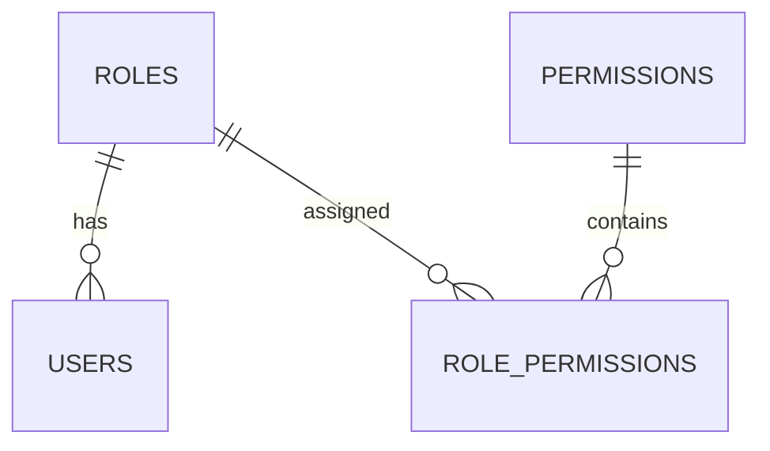
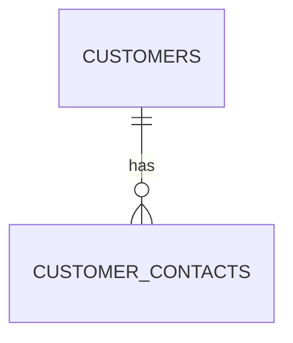
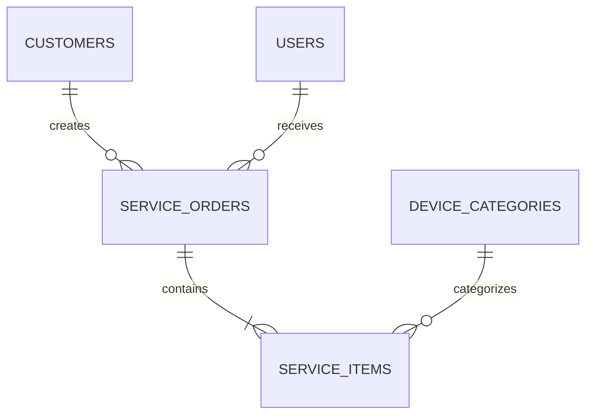
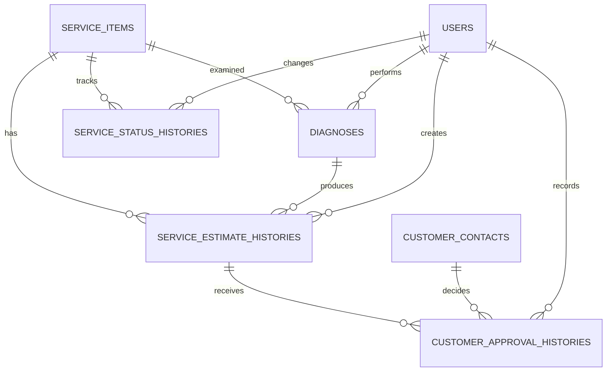
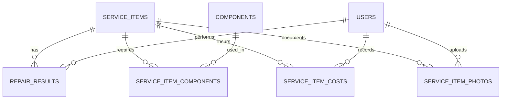
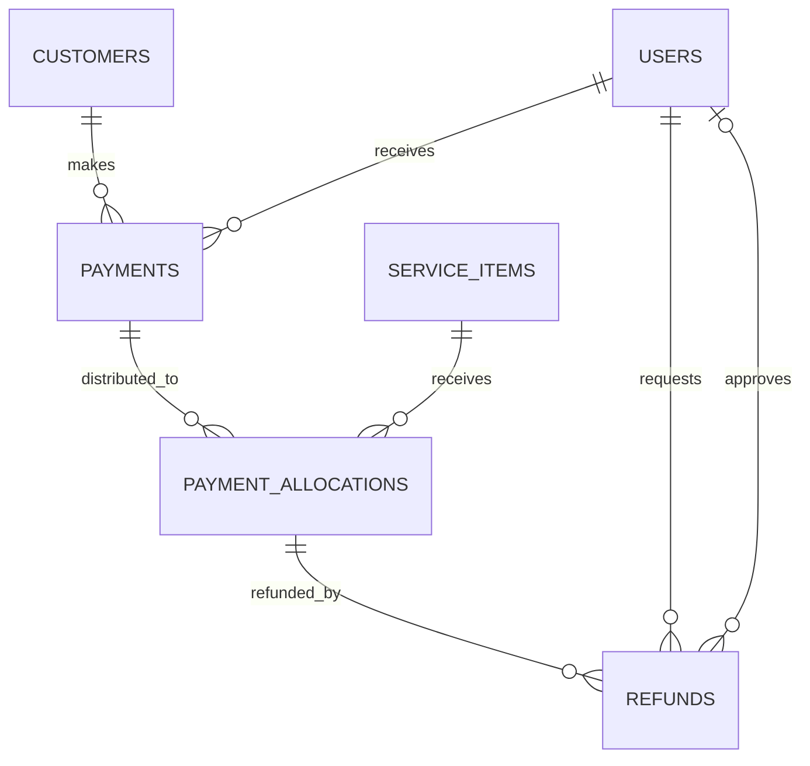
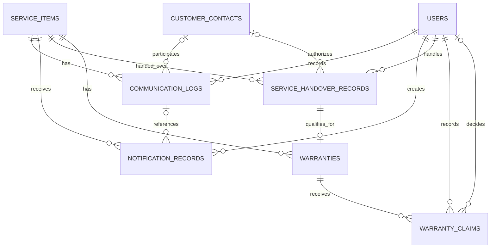
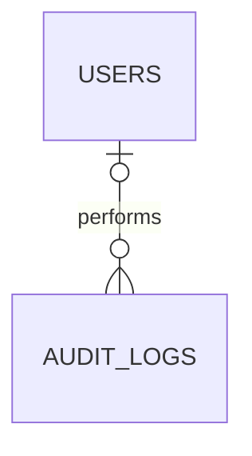

# Entity Relationship Diagram (ERD)
## Electronics Service Management System

| Informasi | Keterangan |
|---|---|
| Nama Proyek | Electronics Service Management System |
| Dokumen | Entity Relationship Diagram |
| Versi | 1.1 |
| Referensi | SRS v1.3 |
| Database | MySQL |
| Backend | Laravel |
| Status | Draft |

---

## 1. Tujuan

Dokumen ini menjelaskan rancangan struktur database untuk
mengelola operasional layanan perbaikan perangkat elektronik.

ERD menjadi acuan dalam menentukan entitas, atribut,
primary key, foreign key, serta hubungan antarentitas
sebelum implementasi database menggunakan Laravel dan MySQL.

## 2. Ruang Lingkup Database

Database mencakup:

1. Pengelolaan pengguna dan hak akses.
2. Pengelolaan pelanggan dan kontak.
3. Penerimaan perangkat dan pesanan servis.
4. Diagnosis dan estimasi biaya.
5. Persetujuan pelanggan dan riwayat status.
6. Pengerjaan servis dan penggunaan komponen.
7. Dokumentasi foto perangkat.
8. Pencatatan biaya, pembayaran, dan refund.
9. Komunikasi dan notifikasi pelanggan.
10. Penyerahan perangkat dan garansi.
11. Riwayat klaim garansi.
12. Audit aktivitas sistem.

## 3. Daftar Kandidat Entitas

### 3.1 Pengguna dan Hak Akses
- roles
- users
- permissions
- role_permissions

### 3.2 Pelanggan dan Penerimaan Servis
- customers
- customer_contacts
- service_orders
- service_items
- device_categories

### 3.3 Diagnosis dan Operasional Servis
- diagnoses
- service_estimate_histories
- customer_approval_histories
- service_status_histories
- repair_results
- components
- service_item_components
- service_item_photos
- service_item_costs

### 3.4 Keuangan
- payments
- payment_allocations
- refunds

### 3.5 Komunikasi dan Purna Servis
- communication_logs
- notification_records
- service_handover_records
- warranties
- warranty_claims

### 3.6 Audit Sistem
- audit_logs

**Total: 27 kandidat entitas.**

Catatan: Daftar ini masih berupa kandidat. Jumlah dan struktur
entitas akan ditetapkan setelah pemeriksaan atribut, relasi,
constraint, serta kesesuaian dengan SRS.

## 4. Konvensi Database

- Nama tabel menggunakan bahasa Inggris.
- Nama tabel menggunakan bentuk plural.
- Penamaan kolom menggunakan snake_case.
- Primary key menggunakan kolom id.
- Foreign key menggunakan format nama_entitas_id.
- Tabel menggunakan timestamps untuk mencatat waktu pembuatan
  dan perubahan data jika diperlukan.
- Data transaksi penting tidak boleh dihapus sembarangan.
- Relasi antarentitas menggunakan foreign key.

## 5. Rancangan Entitas dan Relasi

### 5.1 Pengguna dan Hak Akses

Entitas yang digunakan:
- roles
- users
- permissions
- role_permissions

Relasi:
- roles memiliki banyak users.
- roles memiliki banyak role_permissions.
- permissions memiliki banyak role_permissions.
- Kombinasi role_id dan permission_id harus unik.
- Setiap user hanya memiliki satu role.

Diagram:

### 5.2 Pelanggan dan Kontak Pelanggan

Entitas yang digunakan:
- customers
- customer_contacts

Relasi:
- Satu customer dapat memiliki banyak customer_contacts.
- Setiap customer_contact wajib terhubung dengan satu customer.
- Maksimal satu kontak utama aktif untuk setiap customer.
- Kontak yang dinonaktifkan tidak dihapus dari database.
- Persetujuan WhatsApp dicatat secara terpisah untuk setiap nomor.

Diagram:

### 5.3 Penerimaan Servis dan Perangkat

Entitas yang digunakan:
- service_orders
- service_items
- device_categories

Relasi:
- Satu customer dapat memiliki banyak service_orders.
- Setiap service_order diterima oleh satu user.
- Satu service_order memiliki minimal satu service_item.
- Setiap service_item terhubung dengan satu service_order.
- Setiap service_item memiliki satu kategori perangkat.
- Setiap perangkat memiliki status servis masing-masing.
- Nomor service_order harus unik dengan format SO-YYYY-MM-001.

Diagram:

### 5.4 Diagnosis, Estimasi, Persetujuan, dan Status Servis

Entitas yang digunakan:
- diagnoses
- service_estimate_histories
- customer_approval_histories
- service_status_histories

Relasi:
- Satu service_item dapat memiliki banyak diagnoses.
- Satu diagnosis dapat menghasilkan beberapa revisi estimasi.
- Satu service_item dapat memiliki banyak service_estimate_histories.
- Setiap persetujuan mengacu pada satu estimasi tertentu.
- Persetujuan dicatat berdasarkan customer_contact.
- Setiap service_item dapat memiliki banyak riwayat status.
- Setiap perubahan status dicatat oleh user.

Aturan:
- Estimasi lama tidak ditimpa ketika terjadi revisi.
- Perubahan estimasi yang membutuhkan persetujuan harus mendapat persetujuan baru.
- Riwayat diagnosis, persetujuan, dan status dipertahankan.
- Status terkini disimpan pada service_items.current_status.

Diagram:

### 5.5 Pengerjaan, Komponen, Biaya Aktual, dan Dokumentasi

Entitas yang digunakan:
- repair_results
- components
- service_item_components
- service_item_costs
- service_item_photos

Relasi:
- Satu service_item dapat memiliki banyak repair_results.
- Setiap repair_result dicatat oleh technician.
- Relasi service_items dan components adalah many-to-many melalui service_item_components.
- Satu service_item dapat memiliki banyak service_item_costs.
- Satu service_item dapat memiliki banyak service_item_photos.

Aturan:
- Hasil perbaikan menggunakan SUCCESS atau FAILED.
- Riwayat pengerjaan ulang tetap dipertahankan.
- Penggunaan komponen dicatat dengan status NEEDED, USED, atau NOT_USED.
- Biaya aktual dipisahkan dari estimasi biaya.
- Foto menggunakan tipe BEFORE atau AFTER.
- Foto AFTER wajib tersedia sebelum status menjadi SIAP_DIAMBIL.
- service_item_components digunakan untuk mencatat kebutuhan, jumlah, dan status penggunaan komponen.
- service_item_costs menjadi sumber pencatatan nominal biaya aktual.
- Nominal biaya komponen hanya boleh diperhitungkan satu kali dalam total biaya aktual.
- Jika biaya komponen sudah dicatat pada service_item_costs, sistem tidak boleh menghitungnya kembali dari service_item_components.
- Setiap biaya aktual harus memiliki jenis biaya, deskripsi, nominal, dan pengguna yang mencatat.

Diagram:

### 5.6 Pembayaran, Alokasi Pembayaran, dan Refund

Entitas yang digunakan:
- payments
- payment_allocations
- refunds

Relasi:
- Satu customer dapat memiliki banyak payments.
- Setiap payment dicatat oleh user.
- Satu payment dapat memiliki banyak payment_allocations.
- Satu service_item dapat menerima banyak payment_allocations.
- Satu payment_allocation dapat memiliki banyak refunds.
- Persetujuan refund dicatat oleh Owner.

Aturan:
- Pembayaran dapat dialokasikan ke beberapa perangkat.
- Total alokasi tidak boleh melebihi nominal pembayaran.
- Refund harus terkait dengan payment_allocation.
- Total refund tidak boleh melebihi nominal alokasi.
- Refund membutuhkan persetujuan Owner.
- Riwayat transaksi keuangan harus dipertahankan.

Diagram:

### 5.7 Komunikasi, Notifikasi, dan Purna Servis

Entitas yang digunakan:
- communication_logs
- notification_records
- service_handover_records
- warranties
- warranty_claims

Relasi:
- Satu service_item dapat memiliki banyak communication_logs.
- Satu customer_contact dapat terlibat dalam banyak communication_logs.
- Satu user dapat mencatat banyak communication_logs.
- Satu service_item dapat memiliki banyak notification_records.
- Satu communication_log dapat dikaitkan dengan banyak notification_records, tetapi hubungan tersebut bersifat opsional.
- Satu user dapat membuat banyak notification_records.
- Satu service_item dapat memiliki banyak service_handover_records.
- Satu user dapat mencatat banyak service_handover_records.
- Setiap service_handover_record dapat memiliki maksimal satu warranty.
- Satu service_item dapat memiliki banyak warranties.
- Satu warranty dapat memiliki banyak warranty_claims.
- Setiap warranty_claim dicatat oleh satu user dan dapat diputuskan oleh satu user.

Aturan:
- Komunikasi dan notifikasi dicatat secara terpisah.
- Komunikasi dapat dikaitkan dengan kontak pelanggan, tetapi kontak tersebut bersifat opsional.
- Notifikasi menyimpan nama dan nomor telepon penerima secara langsung.
- Notifikasi dapat dikaitkan dengan communication_log, tetapi hubungan tersebut bersifat opsional.
- Penyerahan perangkat dicatat per perangkat.
- Garansi berlaku 7 hari kalender sejak penyerahan aktual, sesuai ketentuan bisnis.
- Klaim yang dilaporkan selama masa garansi tetap dapat diproses meskipun pemeriksaan dilakukan setelah masa garansi.
- Penyerahan kepada pihak ketiga membutuhkan izin pelanggan.
- Identitas kontak pemberi izin dan metode pemberian izin dicatat jika penyerahan memerlukan otorisasi pihak ketiga.
- Penyerahan langsung kepada pelanggan tidak memerlukan otorisasi pihak ketiga.
- Status pengiriman notifikasi menggunakan PENDING, SENT, atau FAILED sesuai hasil proses pengiriman.
- attempted_at mencatat waktu percobaan pengiriman.
- delivered_at mencatat waktu keberhasilan penyampaian berdasarkan konfirmasi yang tersedia dari layanan pengiriman.
- Jika layanan pengiriman tidak menyediakan konfirmasi penerimaan, sistem tidak boleh menganggap pesan sudah benar-benar diterima pelanggan.
- Perhitungan batas waktu pengambilan menggunakan waktu keberhasilan pengiriman yang dapat diverifikasi.
- Satu handover hanya dapat memiliki maksimal satu warranty.
- Garansi hanya diberikan jika perangkat memenuhi syarat kelayakan.
- warranty_claims mencatat pelaporan, pencatatan, dan keputusan klaim garansi.
- Keputusan klaim menggunakan status PENDING sebagai nilai awal.
- Riwayat klaim tidak memiliki relasi langsung ke klaim sebelumnya.

Diagram:

### 5.8 Audit Aktivitas Sistem

Entitas yang digunakan:
- audit_logs

Relasi:
- Satu user dapat menghasilkan banyak audit_logs.
- Setiap audit_log dapat dikaitkan dengan satu user.
- user_id boleh kosong untuk aktivitas sistem otomatis.

Aturan:
- Aktivitas penting pengguna dicatat.
- Perubahan data dapat menyimpan nilai sebelum dan sesudah perubahan.
- Informasi sensitif seperti password dan token tidak boleh dicatat.
- Audit log tidak menggantikan riwayat transaksi dan operasional.

Diagram:

## 6. Aturan Integritas dan Constraint Database

### 6.1 Primary Key dan Foreign Key

- Setiap tabel memiliki primary key.
- Foreign key harus mengacu pada data yang valid.
- Penghapusan data induk tidak boleh menghilangkan riwayat transaksi penting.
- Penghapusan akun pengguna tidak boleh menghilangkan riwayat aktivitasnya.

### 6.2 Unique Constraint

Kolom atau kombinasi berikut memiliki unique constraint:

- users.email
- roles.name
- permissions.name
- service_orders.order_number
- payments.payment_number
- Kombinasi role_permissions.role_id dan permission_id.
- warranties.handover_record_id.
- device_categories.name
- jobs.uuid (unique constraint bawaan Laravel untuk tabel antrean pekerjaan).

Catatan:
- customers tidak memiliki unique constraint pada nama.
- Setiap service_handover_record hanya dapat memiliki maksimal satu warranty.
- warranty_claims tidak memiliki claim_number atau unique constraint khusus untuk nomor klaim.

### 6.3 Aturan Relasi dan Transaksi

- Satu service_order harus memiliki minimal satu service_item.
- Satu customer_contact hanya dapat menjadi kontak utama aktif untuk satu customer.
- Setiap persetujuan pelanggan harus mengacu pada satu estimasi tertentu.
- Diagnosis dan estimasi harus berasal dari service_item yang sama.
- Setiap perubahan status dan pencatatan riwayatnya dilakukan secara konsisten.
- Pembayaran hanya dapat dialokasikan ke perangkat milik customer yang sama.
- Total payment_allocations tidak boleh melebihi nominal payment.
- Total refund tidak boleh melebihi nominal alokasi pembayaran.
- Satu handover hanya dapat menerbitkan maksimal satu warranty.
- Notification_records yang memiliki communication_log_id harus merujuk pada communication_log untuk service_item yang sama.
- Warranty harus merujuk pada service_item yang sama dengan service_handover_record yang terkait.
- Jika customer_contact_id pada communication_logs diisi, kontak tersebut harus berasal dari customer pemilik service_item.
- Jika authorized_by_contact_id pada service_handover_records diisi, kontak tersebut harus berasal dari customer pemilik service_item.

### 6.4 Aturan Biaya dan Garansi

- Nilai uang menggunakan DECIMAL, bukan FLOAT.
- Biaya aktual dibedakan dari estimasi.
- Biaya komponen tidak boleh dihitung dua kali.
- service_item_costs menjadi sumber pencatatan nominal biaya aktual.
- Biaya komponen yang sudah dicatat dalam service_item_costs tidak boleh dihitung kembali dari service_item_components.
- Garansi hanya dapat diterbitkan untuk perangkat yang telah selesai diperbaiki dan memenuhi ketentuan garansi.
- Hasil pengerjaan SUCCESS menjadi salah satu syarat kelayakan garansi.
- Perangkat dengan hasil pengerjaan FAILED tidak otomatis memperoleh garansi perbaikan.
- Kelayakan garansi dicatat melalui is_eligible.
- Alasan pengecualian atau ketidaklayakan garansi dicatat melalui exclusion_reason.
- Masa garansi dihitung berdasarkan waktu penyerahan aktual.
- starts_at dan expires_at digunakan untuk mencatat periode garansi.
- Klaim dinilai berdasarkan reported_at, yaitu waktu pelanggan melaporkan masalah.
- Klaim yang dilaporkan selama masa garansi tetap dapat diproses meskipun pemeriksaan dilakukan setelah masa garansi berakhir.

### 6.5 Aturan Audit dan Retensi

- Setiap aktivitas penting yang mengubah data harus dicatat dalam audit_logs.
- Audit log menyimpan user_id jika aktivitas dilakukan oleh pengguna yang terautentikasi.
- Jika akun pengguna dihapus, catatan audit tetap dipertahankan dan user_id menjadi NULL.
- action menjelaskan jenis aktivitas yang dilakukan.
- entity_type dan entity_id menunjukkan entitas serta data yang terdampak.
- old_values menyimpan data sebelum perubahan jika tersedia.
- new_values menyimpan data setelah perubahan jika tersedia.
- ip_address dan user_agent digunakan sebagai informasi tambahan untuk penelusuran aktivitas.
- created_at mencatat waktu terjadinya aktivitas audit.
- Audit log bersifat historis dan tidak boleh diubah atau dihapus melalui fitur operasional aplikasi.
- Data audit perlu dilindungi dari akses dan perubahan oleh pengguna yang tidak berwenang.

---

## 7. Kamus Data (Data Dictionary)

Kamus data menjelaskan atribut setiap entitas, tipe data,
primary key, foreign key, serta constraint yang digunakan.

Konvensi tipe data:
- BIGINT UNSIGNED digunakan untuk primary key dan foreign key.
- VARCHAR digunakan untuk teks dengan panjang terbatas.
- TEXT digunakan untuk teks yang lebih panjang.
- BOOLEAN digunakan untuk nilai benar atau salah.
- TIMESTAMP digunakan untuk pencatatan waktu.
- DECIMAL digunakan untuk nilai keuangan.
- JSON digunakan untuk menyimpan data terstruktur jika diperlukan.

### 7.1 Pengguna dan Hak Akses

#### 7.1.1 Tabel roles

| Kolom | Tipe Data | Constraint | Keterangan |
|---|---|---|---|
| id | BIGINT UNSIGNED | PK | ID role |
| name | VARCHAR(50) | UNIQUE, NOT NULL | Nama role |
| description | VARCHAR(255) | NULL | Deskripsi role |
| created_at | TIMESTAMP | NULL | Waktu dibuat |
| updated_at | TIMESTAMP | NULL | Waktu diperbarui |

#### 7.1.2 Tabel users

| Kolom | Tipe Data | Constraint | Keterangan |
|---|---|---|---|
| id | BIGINT UNSIGNED | PK | ID pengguna |
| role_id | BIGINT UNSIGNED | FK, NOT NULL | Role pengguna |
| name | VARCHAR(100) | NOT NULL | Nama pengguna |
| email | VARCHAR(255) | UNIQUE, NOT NULL | Email pengguna |
| password | VARCHAR(255) | NOT NULL | Password hash |
| phone | VARCHAR(20) | NULL | Nomor telepon |
| is_active | BOOLEAN | DEFAULT TRUE | Status akun |
| created_at | TIMESTAMP | NULL | Waktu dibuat |
| updated_at | TIMESTAMP | NULL | Waktu diperbarui |

Foreign key:
- role_id mengacu pada roles.id.

#### 7.1.3 Tabel permissions

| Kolom | Tipe Data | Constraint | Keterangan |
|---|---|---|---|
| id | BIGINT UNSIGNED | PK | ID permission |
| name | VARCHAR(100) | UNIQUE, NOT NULL | Nama permission |
| description | VARCHAR(255) | NULL | Deskripsi permission |
| created_at | TIMESTAMP | NULL | Waktu dibuat |
| updated_at | TIMESTAMP | NULL | Waktu diperbarui |

#### 7.1.4 Tabel role_permissions

| Kolom | Tipe Data | Constraint | Keterangan |
|---|---|---|---|
| id | BIGINT UNSIGNED | PK | ID relasi |
| role_id | BIGINT UNSIGNED | FK, NOT NULL | ID role |
| permission_id | BIGINT UNSIGNED | FK, NOT NULL | ID permission |
| created_at | TIMESTAMP | NULL | Waktu dibuat |
| updated_at | TIMESTAMP | NULL | Waktu diperbarui |

Foreign key:
- role_id mengacu pada roles.id.
- permission_id mengacu pada permissions.id.

Unique constraint:
- Kombinasi role_id dan permission_id harus unik.

### 7.2 Pelanggan dan Kontak Pelanggan

#### 7.2.1 Tabel customers

| Kolom | Tipe Data | Constraint | Keterangan |
|---|---|---|---|
| id | BIGINT UNSIGNED | PK | ID pelanggan |
| name | VARCHAR(100) | NOT NULL | Nama pelanggan |
| address | TEXT | NULL | Alamat pelanggan |
| notes | TEXT | NULL | Catatan tambahan |
| created_at | TIMESTAMP | NULL | Waktu dibuat |
| updated_at | TIMESTAMP | NULL | Waktu diperbarui |

#### 7.2.2 Tabel customer_contacts

| Kolom | Tipe Data | Constraint | Keterangan |
|---|---|---|---|
| id | BIGINT UNSIGNED | PK | ID kontak |
| customer_id | BIGINT UNSIGNED | FK, NOT NULL | Pemilik kontak |
| contact_name | VARCHAR(100) | NOT NULL | Nama pemilik nomor |
| phone_number | VARCHAR(20) | NOT NULL | Nomor telepon |
| is_primary | BOOLEAN | DEFAULT FALSE | Kontak utama |
| whatsapp_consent | BOOLEAN | DEFAULT FALSE | Persetujuan WhatsApp |
| is_active | BOOLEAN | DEFAULT TRUE | Status kontak |
| created_at | TIMESTAMP | NULL | Waktu dibuat |
| updated_at | TIMESTAMP | NULL | Waktu diperbarui |

Foreign key:
- customer_id mengacu pada customers.id.

Aturan:
- Satu customer dapat memiliki beberapa customer_contacts.
- Maksimal satu kontak utama yang aktif untuk setiap customer.
- Kontak yang tidak aktif tetap disimpan untuk menjaga riwayat.
- Persetujuan WhatsApp berlaku untuk masing-masing nomor telepon.
- Nomor telepon tidak diwajibkan unik secara global.

### 7.3 Penerimaan Servis dan Perangkat

#### 7.3.1 Tabel service_orders

| Kolom | Tipe Data | Constraint | Keterangan |
|---|---|---|---|
| id | BIGINT UNSIGNED | PK | ID pesanan servis |
| order_number | VARCHAR(30) | UNIQUE, NOT NULL | Nomor pesanan servis |
| customer_id | BIGINT UNSIGNED | FK, NOT NULL | Pemilik pesanan |
| received_by | BIGINT UNSIGNED | FK, NOT NULL | Pengguna yang menerima |
| received_at | TIMESTAMP | NOT NULL | Waktu penerimaan |
| received_from_name | VARCHAR(100) | NOT NULL | Nama orang yang mengantarkan perangkat |
| received_from_phone | VARCHAR(20) | NULL | Nomor telepon pengantar |
| received_from_relationship | VARCHAR(50) | NULL | Hubungan pengantar dengan pelanggan |
| general_notes | TEXT | NULL | Catatan umum pesanan |
| created_at | TIMESTAMP | NULL | Waktu dibuat |
| updated_at | TIMESTAMP | NULL | Waktu diperbarui |

Foreign key:
- customer_id mengacu pada customers.id.
- received_by mengacu pada users.id.

Aturan:
- Data customer tetap mengacu pada pemilik atau pelanggan yang bertanggung jawab atas servis.
- Orang yang mengantarkan perangkat dapat berbeda dari customer.
- Identitas orang yang mengantarkan perangkat dicatat pada service_order.

#### 7.3.2 Tabel device_categories

| Kolom | Tipe Data | Constraint | Keterangan |
|---|---|---|---|
| id | BIGINT UNSIGNED | PK | ID kategori |
| name | VARCHAR(100) | UNIQUE, NOT NULL | Nama kategori perangkat |
| description | VARCHAR(255) | NULL | Deskripsi kategori |
| is_active | BOOLEAN | DEFAULT TRUE | Status kategori |
| created_at | TIMESTAMP | NULL | Waktu dibuat |
| updated_at | TIMESTAMP | NULL | Waktu diperbarui |

Kategori awal:
- TV & Display
- Audio
- Home Appliances
- Kitchen
- Electrical & Power

#### 7.3.3 Tabel service_items

| Kolom | Tipe Data | Constraint | Keterangan |
|---|---|---|---|
| id | BIGINT UNSIGNED | PK | ID perangkat servis |
| service_order_id | BIGINT UNSIGNED | FK, NOT NULL | Pesanan induk |
| category_id | BIGINT UNSIGNED | FK, NOT NULL | Kategori perangkat |
| device_name | VARCHAR(150) | NOT NULL | Nama perangkat |
| brand | VARCHAR(100) | NULL | Merek perangkat |
| specifications | TEXT | NULL | Spesifikasi perangkat |
| complaint | TEXT | NOT NULL | Keluhan pelanggan |
| physical_condition | TEXT | NULL | Kondisi fisik saat diterima |
| accessories | TEXT | NULL | Aksesori yang disertakan |
| current_status | VARCHAR(50) | NOT NULL | Status servis terkini |
| created_at | TIMESTAMP | NULL | Waktu dibuat |
| updated_at | TIMESTAMP | NULL | Waktu diperbarui |

Foreign key:
- service_order_id mengacu pada service_orders.id.
- category_id mengacu pada device_categories.id.

Aturan:
- Satu service_order harus memiliki minimal satu service_item.
- Setiap perangkat memiliki status servis masing-masing.
- Nomor pesanan menggunakan format SO-YYYY-MM-001.
- Data penerimaan setiap perangkat dicatat secara terpisah.
- Status terkini harus konsisten dengan riwayat status.

### 7.4 Diagnosis, Estimasi, Persetujuan, dan Riwayat Status

#### 7.4.1 Tabel diagnoses

| Kolom | Tipe Data | Constraint | Keterangan |
|---|---|---|---|
| id | BIGINT UNSIGNED | PK | ID diagnosis |
| service_item_id | BIGINT UNSIGNED | FK, NOT NULL | Perangkat yang diperiksa |
| technician_id | BIGINT UNSIGNED | FK, NOT NULL | Teknisi pemeriksa |
| diagnosis_notes | TEXT | NOT NULL | Hasil diagnosis |
| diagnosed_at | TIMESTAMP | NOT NULL | Waktu diagnosis |
| created_at | TIMESTAMP | NULL | Waktu pencatatan |

Foreign key:
- service_item_id mengacu pada service_items.id.
- technician_id mengacu pada users.id.

#### 7.4.2 Tabel service_estimate_histories

| Kolom | Tipe Data | Constraint | Keterangan |
|---|---|---|---|
| id | BIGINT UNSIGNED | PK | ID estimasi |
| service_item_id | BIGINT UNSIGNED | FK, NOT NULL | Perangkat servis |
| diagnosis_id | BIGINT UNSIGNED | FK, NOT NULL | Diagnosis terkait |
| estimated_cost | DECIMAL(15,2) | NOT NULL | Estimasi biaya |
| revision_number | INT UNSIGNED | NOT NULL | Nomor revisi |
| created_by | BIGINT UNSIGNED | FK, NOT NULL | Pembuat estimasi |
| created_at | TIMESTAMP | NOT NULL | Waktu estimasi dibuat |

Foreign key:
- service_item_id mengacu pada service_items.id.
- diagnosis_id mengacu pada diagnoses.id.
- created_by mengacu pada users.id.

Unique constraint:
- Kombinasi service_item_id dan revision_number harus unik.

#### 7.4.3 Tabel customer_approval_histories

| Kolom | Tipe Data | Constraint | Keterangan |
|---|---|---|---|
| id | BIGINT UNSIGNED | PK | ID persetujuan |
| estimate_history_id | BIGINT UNSIGNED | FK, NOT NULL | Estimasi yang disetujui |
| customer_contact_id | BIGINT UNSIGNED | FK, NOT NULL | Kontak pemberi keputusan |
| recorded_by | BIGINT UNSIGNED | FK, NOT NULL | Pengguna pencatat |
| decision | VARCHAR(20) | NOT NULL | APPROVED atau REJECTED |
| decision_notes | TEXT | NULL | Catatan keputusan |
| decided_at | TIMESTAMP | NOT NULL | Waktu keputusan |

Foreign key:
- estimate_history_id mengacu pada service_estimate_histories.id.
- customer_contact_id mengacu pada customer_contacts.id.
- recorded_by mengacu pada users.id.

#### 7.4.4 Tabel service_status_histories

| Kolom | Tipe Data | Constraint | Keterangan |
|---|---|---|---|
| id | BIGINT UNSIGNED | PK | ID riwayat status |
| service_item_id | BIGINT UNSIGNED | FK, NOT NULL | Perangkat servis |
| previous_status | VARCHAR(50) | NULL | Status sebelumnya |
| new_status | VARCHAR(50) | NOT NULL | Status baru |
| changed_by | BIGINT UNSIGNED | FK, NOT NULL | Pengguna yang mengubah |
| notes | TEXT | NULL | Catatan perubahan |
| changed_at | TIMESTAMP | NOT NULL | Waktu perubahan |

Foreign key:
- service_item_id mengacu pada service_items.id.
- changed_by mengacu pada users.id.

Aturan:
- Setiap revisi estimasi disimpan sebagai data baru.
- Persetujuan pelanggan mengacu pada estimasi tertentu.
- Diagnosis dan estimasi harus berasal dari perangkat servis yang sama.
- Kontak pemberi persetujuan harus merupakan kontak dari pelanggan pemilik perangkat.
- Setiap perubahan status dicatat dalam service_status_histories.
- Status terkini disimpan pada service_items.current_status.
- Perubahan status dan pencatatan riwayat dilakukan dalam satu transaksi database.

### 7.5 Pengerjaan, Komponen, Biaya Aktual, dan Dokumentasi

#### 7.5.1 Tabel repair_results

| Kolom | Tipe Data | Constraint | Keterangan |
|---|---|---|---|
| id | BIGINT UNSIGNED | PK | ID hasil pengerjaan |
| service_item_id | BIGINT UNSIGNED | FK, NOT NULL | Perangkat servis |
| technician_id | BIGINT UNSIGNED | FK, NOT NULL | Teknisi pengerjaan |
| result | VARCHAR(20) | NOT NULL | SUCCESS atau FAILED |
| repair_notes | TEXT | NOT NULL | Catatan hasil perbaikan |
| completed_at | TIMESTAMP | NOT NULL | Waktu pengerjaan selesai |
| created_at | TIMESTAMP | NULL | Waktu pencatatan |

Foreign key:
- service_item_id mengacu pada service_items.id.
- technician_id mengacu pada users.id.

#### 7.5.2 Tabel components

| Kolom | Tipe Data | Constraint | Keterangan |
|---|---|---|---|
| id | BIGINT UNSIGNED | PK | ID komponen |
| name | VARCHAR(150) | NOT NULL | Nama komponen |
| description | TEXT | NULL | Deskripsi komponen |
| is_active | BOOLEAN | DEFAULT TRUE | Status komponen |
| created_at | TIMESTAMP | NULL | Waktu dibuat |
| updated_at | TIMESTAMP | NULL | Waktu diperbarui |

#### 7.5.3 Tabel service_item_components

| Kolom | Tipe Data | Constraint | Keterangan |
|---|---|---|---|
| id | BIGINT UNSIGNED | PK | ID penggunaan komponen |
| service_item_id | BIGINT UNSIGNED | FK, NOT NULL | Perangkat servis |
| component_id | BIGINT UNSIGNED | FK, NOT NULL | Komponen terkait |
| quantity | INT UNSIGNED | NOT NULL | Jumlah komponen |
| usage_status | VARCHAR(20) | NOT NULL | NEEDED, USED, atau NOT_USED |
| notes | TEXT | NULL | Catatan penggunaan |
| created_at | TIMESTAMP | NULL | Waktu dibuat |
| updated_at | TIMESTAMP | NULL | Waktu diperbarui |

Foreign key:
- service_item_id mengacu pada service_items.id.
- component_id mengacu pada components.id.

#### 7.5.4 Tabel service_item_costs

| Kolom | Tipe Data | Constraint | Keterangan |
|---|---|---|---|
| id | BIGINT UNSIGNED | PK | ID biaya aktual |
| service_item_id | BIGINT UNSIGNED | FK, NOT NULL | Perangkat servis |
| recorded_by | BIGINT UNSIGNED | FK, NOT NULL | Pengguna pencatat |
| cost_type | VARCHAR(20) | NOT NULL | LABOR, PART, atau OTHER |
| description | TEXT | NOT NULL | Deskripsi biaya |
| amount | DECIMAL(15,2) | NOT NULL | Nominal biaya |
| created_at | TIMESTAMP | NOT NULL | Waktu pencatatan |

Foreign key:
- service_item_id mengacu pada service_items.id.
- recorded_by mengacu pada users.id.

#### 7.5.5 Tabel service_item_photos

| Kolom | Tipe Data | Constraint | Keterangan |
|---|---|---|---|
| id | BIGINT UNSIGNED | PK | ID foto |
| service_item_id | BIGINT UNSIGNED | FK, NOT NULL | Perangkat servis |
| uploaded_by | BIGINT UNSIGNED | FK, NOT NULL | Pengguna pengunggah |
| photo_type | VARCHAR(20) | NOT NULL | BEFORE atau AFTER |
| file_path | VARCHAR(255) | NOT NULL | Lokasi file foto |
| caption | VARCHAR(255) | NULL | Keterangan foto |
| uploaded_at | TIMESTAMP | NOT NULL | Waktu unggah |

Foreign key:
- service_item_id mengacu pada service_items.id.
- uploaded_by mengacu pada users.id.

Aturan:
- Satu perangkat dapat memiliki beberapa catatan pengerjaan.
- Hasil pengerjaan menggunakan SUCCESS atau FAILED.
- Penggunaan komponen dicatat secara terpisah dari nominal biaya.
- Biaya aktual disimpan pada service_item_costs.
- Foto disimpan pada storage aplikasi, sedangkan database menyimpan lokasi file.
- Foto BEFORE wajib tersedia sebagai dokumentasi penerimaan.
- Foto AFTER wajib tersedia sebelum perangkat dinyatakan SIAP_DIAMBIL.
- Hasil perbaikan yang gagal tidak otomatis mewajibkan biaya pemeriksaan.

### 7.6 Pembayaran, Alokasi Pembayaran, dan Refund

#### 7.6.1 Tabel payments

| Kolom | Tipe Data | Constraint | Keterangan |
|---|---|---|---|
| id | BIGINT UNSIGNED | PK | ID pembayaran |
| payment_number | VARCHAR(30) | UNIQUE, NOT NULL | Nomor transaksi pembayaran |
| customer_id | BIGINT UNSIGNED | FK, NOT NULL | Pelanggan pembayar |
| received_by | BIGINT UNSIGNED | FK, NOT NULL | Pengguna penerima pembayaran |
| amount | DECIMAL(15,2) | NOT NULL | Nominal pembayaran |
| payment_method | VARCHAR(30) | NOT NULL | Metode pembayaran |
| payment_date | TIMESTAMP | NOT NULL | Waktu pembayaran |
| reference_number | VARCHAR(100) | NULL | Nomor referensi transaksi |
| notes | TEXT | NULL | Catatan pembayaran |
| created_at | TIMESTAMP | NULL | Waktu pencatatan |

Foreign key:
- customer_id mengacu pada customers.id.
- received_by mengacu pada users.id.

#### 7.6.2 Tabel payment_allocations

| Kolom | Tipe Data | Constraint | Keterangan |
|---|---|---|---|
| id | BIGINT UNSIGNED | PK | ID alokasi |
| payment_id | BIGINT UNSIGNED | FK, NOT NULL | Transaksi pembayaran |
| service_item_id | BIGINT UNSIGNED | FK, NOT NULL | Perangkat tujuan pembayaran |
| allocated_amount | DECIMAL(15,2) | NOT NULL | Nominal yang dialokasikan |
| created_at | TIMESTAMP | NOT NULL | Waktu alokasi |

Foreign key:
- payment_id mengacu pada payments.id.
- service_item_id mengacu pada service_items.id.

#### 7.6.3 Tabel refunds

| Kolom | Tipe Data | Constraint | Keterangan |
|---|---|---|---|
| id | BIGINT UNSIGNED | PK | ID refund |
| payment_allocation_id | BIGINT UNSIGNED | FK, NOT NULL | Alokasi pembayaran terkait |
| requested_by | BIGINT UNSIGNED | FK, NOT NULL | Pengguna pengaju refund |
| approved_by | BIGINT UNSIGNED | FK, NULL | Owner yang menyetujui |
| amount | DECIMAL(15,2) | NOT NULL | Nominal refund |
| reason | TEXT | NOT NULL | Alasan refund |
| refund_status | VARCHAR(20) | NOT NULL | Status refund |
| refunded_at | TIMESTAMP | NULL | Waktu pengembalian dana |
| created_at | TIMESTAMP | NOT NULL | Waktu permintaan dicatat |

Foreign key:
- payment_allocation_id mengacu pada payment_allocations.id.
- requested_by mengacu pada users.id.
- approved_by mengacu pada users.id.

Aturan:
- Satu pembayaran dapat dialokasikan ke beberapa perangkat.
- Satu perangkat dapat menerima beberapa alokasi pembayaran.
- Total alokasi tidak boleh melebihi nominal pembayaran.
- Alokasi pembayaran hanya boleh ditujukan kepada perangkat milik customer yang sama dengan pemilik pembayaran.
- Total refund tidak boleh melebihi nominal alokasi pembayaran.
- Refund harus melalui persetujuan Owner.
- approved_by boleh NULL selama refund belum disetujui.
- refunded_at hanya diisi setelah pengembalian dana benar-benar dilakukan.
- Transaksi pembayaran yang telah selesai tidak boleh dihapus.
- Pembayaran yang belum dialokasikan tetap dapat disimpan.

### 7.7 Komunikasi, Notifikasi, dan Purna Servis

#### 7.7.1 Tabel communication_logs

| Kolom | Tipe Data | Constraint | Keterangan |
|---|---|---|---|
| id | BIGINT UNSIGNED | PK | ID komunikasi |
| service_item_id | BIGINT UNSIGNED | FK, NOT NULL | Perangkat servis |
| customer_contact_id | BIGINT UNSIGNED | FK, NULL | Kontak pelanggan terkait |
| recorded_by | BIGINT UNSIGNED | FK, NOT NULL | Pengguna pencatat |
| communication_type | VARCHAR(30) | NOT NULL | Jenis komunikasi |
| direction | VARCHAR(20) | NULL | Arah komunikasi |
| recipient_name | VARCHAR(150) | NULL | Nama penerima |
| recipient_phone | VARCHAR(30) | NULL | Nomor telepon penerima |
| message | TEXT | NOT NULL | Isi atau ringkasan komunikasi |
| proof_path | VARCHAR(500) | NULL | Lokasi bukti komunikasi |
| communicated_at | DATETIME | NOT NULL | Waktu komunikasi |
| created_at | TIMESTAMP | NULL | Waktu pembuatan data |
| updated_at | TIMESTAMP | NULL | Waktu pembaruan data |

Foreign key:
- service_item_id mengacu pada service_items.id dengan ON DELETE RESTRICT.
- customer_contact_id mengacu pada customer_contacts.id dengan ON DELETE SET NULL.
- recorded_by mengacu pada users.id dengan ON DELETE RESTRICT.

#### 7.7.2 Tabel notification_records

| Kolom | Tipe Data | Constraint | Keterangan |
|---|---|---|---|
| id | BIGINT UNSIGNED | PK | ID notifikasi |
| service_item_id | BIGINT UNSIGNED | FK, NOT NULL | Perangkat servis |
| communication_log_id | BIGINT UNSIGNED | FK, NULL | Referensi komunikasi terkait |
| created_by | BIGINT UNSIGNED | FK, NOT NULL | Pengguna pembuat |
| notification_type | VARCHAR(30) | NOT NULL | Jenis notifikasi |
| delivery_status | VARCHAR(20) | NOT NULL, DEFAULT PENDING | Status pengiriman |
| recipient_name | VARCHAR(150) | NULL | Nama penerima |
| recipient_phone | VARCHAR(30) | NOT NULL | Nomor telepon penerima |
| message | TEXT | NOT NULL | Isi notifikasi |
| proof_path | VARCHAR(500) | NULL | Lokasi bukti pengiriman |
| attempted_at | DATETIME | NULL | Waktu percobaan pengiriman |
| delivered_at | DATETIME | NULL | Waktu keberhasilan penyampaian |
| failure_reason | TEXT | NULL | Alasan kegagalan pengiriman |
| created_at | TIMESTAMP | NULL | Waktu pembuatan data |
| updated_at | TIMESTAMP | NULL | Waktu pembaruan data |

Foreign key:
- service_item_id mengacu pada service_items.id dengan ON DELETE RESTRICT.
- communication_log_id mengacu pada communication_logs.id dengan ON DELETE SET NULL.
- created_by mengacu pada users.id dengan ON DELETE RESTRICT.

#### 7.7.3 Tabel service_handover_records

| Kolom | Tipe Data | Constraint | Keterangan |
|---|---|---|---|
| id | BIGINT UNSIGNED | PK | ID penyerahan |
| service_item_id | BIGINT UNSIGNED | FK, NOT NULL | Perangkat yang diserahkan |
| handed_over_by | BIGINT UNSIGNED | FK, NOT NULL | Pengguna yang menyerahkan |
| recipient_name | VARCHAR(150) | NOT NULL | Nama penerima |
| recipient_phone | VARCHAR(30) | NULL | Nomor telepon penerima |
| recipient_type | VARCHAR(30) | NOT NULL | Jenis penerima |
| authorized_by_contact_id | BIGINT UNSIGNED | FK, NULL | Kontak pemberi izin |
| authorization_method | VARCHAR(50) | NULL | Metode pemberian izin |
| authorization_notes | TEXT | NULL | Catatan otorisasi |
| proof_path | VARCHAR(500) | NULL | Lokasi bukti penyerahan |
| handed_over_at | DATETIME | NOT NULL | Waktu penyerahan aktual |
| notes | TEXT | NULL | Catatan tambahan |
| created_at | TIMESTAMP | NULL | Waktu pembuatan data |
| updated_at | TIMESTAMP | NULL | Waktu pembaruan data |

Foreign key:
- service_item_id mengacu pada service_items.id dengan ON DELETE RESTRICT.
- handed_over_by mengacu pada users.id dengan ON DELETE RESTRICT.
- authorized_by_contact_id mengacu pada customer_contacts.id dengan ON DELETE SET NULL.

#### 7.7.4 Tabel warranties

| Kolom | Tipe Data | Constraint | Keterangan |
|---|---|---|---|
| id | BIGINT UNSIGNED | PK | ID garansi |
| service_item_id | BIGINT UNSIGNED | FK, NOT NULL | Perangkat yang memperoleh garansi |
| handover_record_id | BIGINT UNSIGNED | FK, UNIQUE, NOT NULL | Penyerahan terkait |
| starts_at | DATETIME | NOT NULL | Waktu mulai garansi |
| expires_at | DATETIME | NOT NULL | Waktu berakhir garansi |
| is_eligible | BOOLEAN | NOT NULL, DEFAULT TRUE | Status kelayakan garansi |
| exclusion_reason | VARCHAR(255) | NULL | Alasan ketidaklayakan atau pengecualian |
| created_at | TIMESTAMP | NULL | Waktu pembuatan data |
| updated_at | TIMESTAMP | NULL | Waktu pembaruan data |

Foreign key:
- service_item_id mengacu pada service_items.id dengan ON DELETE RESTRICT.
- handover_record_id mengacu pada service_handover_records.id dengan ON DELETE RESTRICT.

Constraint tambahan:
- handover_record_id memiliki unique constraint sehingga satu penyerahan hanya dapat memiliki maksimal satu warranty.
- Satu service_item dapat memiliki lebih dari satu warranty apabila terdapat beberapa catatan penyerahan yang berbeda.
- Kesesuaian service_item_id dengan service_item pada handover_record_id harus divalidasi oleh aplikasi.

#### 7.7.5 Tabel warranty_claims

| Kolom | Tipe Data | Constraint | Keterangan |
|---|---|---|---|
| id | BIGINT UNSIGNED | PK | ID klaim |
| warranty_id | BIGINT UNSIGNED | FK, NOT NULL | Garansi terkait |
| recorded_by | BIGINT UNSIGNED | FK, NOT NULL | Pengguna pencatat klaim |
| decided_by | BIGINT UNSIGNED | FK, NULL | Pengguna yang memutuskan klaim |
| reported_at | DATETIME | NOT NULL | Waktu pelanggan melaporkan masalah |
| recorded_at | DATETIME | NOT NULL | Waktu klaim dicatat |
| issue_description | TEXT | NOT NULL | Deskripsi masalah |
| decision | VARCHAR(30) | NOT NULL, DEFAULT PENDING | Keputusan klaim |
| decided_at | DATETIME | NULL | Waktu keputusan |
| decision_notes | TEXT | NULL | Catatan keputusan |
| proof_path | VARCHAR(500) | NULL | Lokasi bukti klaim |
| created_at | TIMESTAMP | NULL | Waktu pembuatan data |
| updated_at | TIMESTAMP | NULL | Waktu pembaruan data |

Foreign key:
- warranty_id mengacu pada warranties.id dengan ON DELETE RESTRICT.
- recorded_by mengacu pada users.id dengan ON DELETE RESTRICT.
- decided_by mengacu pada users.id dengan ON DELETE RESTRICT.

Aturan:
- Komunikasi pelanggan dan notifikasi resmi dicatat secara terpisah.
- customer_contact_id pada communication_logs bersifat opsional.
- Notifikasi menyimpan nama dan nomor telepon penerima secara langsung.
- communication_log_id pada notification_records bersifat opsional.
- Penyerahan perangkat dicatat untuk setiap service_item.
- Penerima pihak ketiga harus memiliki izin pelanggan yang terdokumentasi.
- Setiap handover hanya dapat menerbitkan maksimal satu warranty.
- Garansi berlaku selama 7 hari kalender sejak penyerahan aktual, sesuai ketentuan bisnis.
- Garansi hanya diberikan kepada perangkat yang memenuhi persyaratan kelayakan.
- Status kelayakan dicatat melalui is_eligible.
- Alasan pengecualian atau ketidaklayakan dicatat melalui exclusion_reason.
- Kerusakan akibat petir tidak termasuk cakupan garansi apabila ditetapkan dalam ketentuan garansi.
- Klaim dinilai berdasarkan waktu pelaporan pelanggan.
- Klaim yang dilaporkan selama masa garansi tetap dapat diproses meskipun pemeriksaan dilakukan setelah masa garansi berakhir.
- Satu warranty dapat memiliki beberapa warranty_claims.
- Keputusan klaim menggunakan PENDING sebagai nilai awal.
- Riwayat klaim tidak memiliki relasi langsung ke klaim sebelumnya.

### 7.8 Audit Aktivitas Sistem

#### 7.8.1 Tabel audit_logs

| Kolom | Tipe Data | Constraint | Keterangan |
|---|---|---|---|
| id | BIGINT UNSIGNED | PK | ID audit |
| user_id | BIGINT UNSIGNED | FK, NULL | Pengguna pelaku aktivitas |
| action | VARCHAR(100) | NOT NULL | Jenis aktivitas |
| entity_type | VARCHAR(100) | NOT NULL | Nama entitas yang berubah |
| entity_id | BIGINT UNSIGNED | NOT NULL | ID data yang terkait |
| old_values | JSON | NULL | Data sebelum perubahan |
| new_values | JSON | NULL | Data setelah perubahan |
| ip_address | VARCHAR(45) | NULL | Alamat IP pengguna |
| user_agent | TEXT | NULL | Informasi browser atau perangkat |
| created_at | DATETIME | NOT NULL | Waktu aktivitas |

Foreign key:
- user_id mengacu pada users.id dengan ON DELETE SET NULL.

Index:
- audit_entity_idx pada entity_type dan entity_id.
- audit_user_idx pada user_id.
- audit_created_idx pada created_at.

Aturan:
- Audit log mencatat aktivitas penting pengguna dan sistem.
- old_values menyimpan nilai sebelum perubahan jika diperlukan.
- new_values menyimpan nilai setelah perubahan jika diperlukan.
- user_id boleh NULL untuk aktivitas sistem otomatis.
- Jika pengguna dihapus, catatan audit tetap dipertahankan dan user_id menjadi NULL.
- created_at wajib diisi saat pencatatan aktivitas audit.
- Audit log digunakan sebagai catatan historis dan tidak boleh diubah melalui fitur operasional aplikasi.
- Akses terhadap audit log harus dibatasi kepada pengguna yang berwenang.

---

## 8. Aturan Implementasi dan Validasi Aplikasi

Beberapa aturan bisnis memerlukan validasi pada level aplikasi karena tidak dapat dijamin hanya menggunakan foreign key atau unique constraint biasa.

### 8.1 Validasi Relasi

- Diagnosis dan estimasi harus berasal dari service_item yang sama.
- Kontak pemberi persetujuan harus berasal dari customer pemilik perangkat.
- Alokasi pembayaran hanya dapat ditujukan kepada perangkat milik customer yang sama dengan pemilik pembayaran.
- Kontak pemberi izin penyerahan harus berasal dari customer pemilik perangkat.
- Jika customer_contact_id pada communication_logs diisi, kontak tersebut harus berasal dari customer pemilik service_item.
- Jika communication_log_id pada notification_records diisi, communication_log tersebut harus berasal dari service_item yang sama.
- service_item_id pada warranties harus sesuai dengan service_item yang dimiliki handover_record_id terkait.

### 8.2 Validasi Transaksi Keuangan

- Total alokasi pembayaran tidak boleh melebihi nominal payment.
- Total refund yang telah disetujui atau diselesaikan tidak boleh melebihi nominal alokasi pembayaran terkait.
- Proses pencatatan pembayaran, alokasi, dan refund harus menggunakan database transaction.
- Validasi nominal harus dilakukan sebelum transaksi disimpan.
- Data transaksi yang telah selesai tidak boleh dihapus melalui operasi biasa.
- Perubahan atau pembatalan transaksi harus memiliki catatan yang dapat ditelusuri.

### 8.3 Validasi Alur Servis

- Service order harus memiliki minimal satu service_item.
- Foto BEFORE wajib tersedia pada proses penerimaan.
- Foto AFTER wajib tersedia sebelum perangkat dinyatakan siap diambil.
- Perubahan estimasi yang membutuhkan persetujuan harus memperoleh persetujuan baru.
- Status servis dan riwayat status harus diperbarui secara konsisten.
- Penggunaan komponen dan pencatatan biaya aktual harus mengacu pada service_item yang benar.
- Setiap perubahan data penting harus dicatat dalam audit_logs.

### 8.4 Validasi Penyerahan dan Garansi

- Penyerahan kepada pihak ketiga wajib memiliki bukti izin pelanggan.
- Garansi hanya diterbitkan untuk perbaikan yang memenuhi syarat.
- Setiap service_handover_record hanya dapat memiliki maksimal satu warranty.
- Tanggal mulai garansi mengikuti waktu penyerahan aktual.
- Masa garansi mengikuti ketentuan bisnis, yaitu 7 hari kalender.
- Klaim yang dilaporkan selama masa garansi tetap dapat diproses meskipun pemeriksaan dilakukan setelah masa garansi berakhir.
- Waktu pelaporan klaim harus dicatat secara akurat melalui reported_at.
- Batas waktu pengambilan perangkat dihitung berdasarkan keberhasilan penyampaian notifikasi yang dapat diverifikasi.
- Jika layanan pengiriman tidak menyediakan konfirmasi penerimaan, sistem tidak boleh menganggap notifikasi telah diterima pelanggan.

### 8.5 Validasi dan Retensi Data

- Maksimal satu kontak utama aktif untuk setiap customer.
- Data historis tetap dipertahankan ketika akun atau kontak dinonaktifkan.
- Audit log tidak boleh menyimpan password atau token.
- Penghapusan data historis mengikuti kebijakan retensi sistem.
- Penghapusan akun pengguna tidak boleh menghilangkan catatan audit.
- Perubahan terhadap audit log harus dibatasi dan tidak tersedia melalui fitur operasional biasa.
- Data dan bukti transaksi harus dilindungi dari akses pengguna yang tidak berwenang.